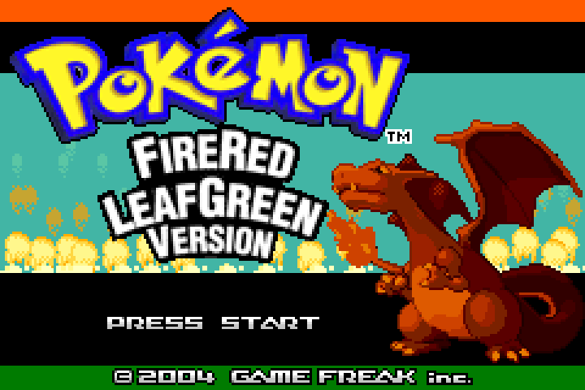

# FRLGV.IPS

> It's as you remember it...

This holds the repository for a ROM hack that includes a new rock by the water and the Trainer-fly glitch. (hence the name)

Sporadic updates, though I do hope to finish it maybe...

# Features

- All POKéMON on both FireRed and LeafGreen are obtainable in the wild.
- Most tutorials have been removed.
- ~~Events made obtainable by default~~
- Miscellaneous QOL features
- 1 new

# Story

I recommend you figure out this yourself :3c

No outside knowledge is needed for this hack!!

# Credits

- [Fire Red Overworld Sprite Resource](https://www.pokecommunity.com/threads/fire-red-overworld-sprite-resource.407124/)
- [Allistair's FRLG Style overworld tilesets](https://github.com/TeamAquasHideout/Team-Aquas-Asset-Repo/tree/main/Tilesets/Other%20Tilesets/Ewraz%20Collected%20Tilesets)
- [aveontrainer](https://www.deviantart.com/aveontrainer) (school tilesets)
- [Kalarie](https://github.com/TeamAquasHideout/Team-Aquas-Asset-Repo/tree/main/Trainer%20Front%20Sprites/Kalarie) (trainer sprites)
- hyo (trainer sprites)
- muzyun (trainer sprites)
- Kasen (trainer sprites)
- Vicki (support)
- Claire (move animations, tech advice)
- Nullrot (trainer sprites)
- Emily (writing advice)
- MezmerKaiser (various music)
